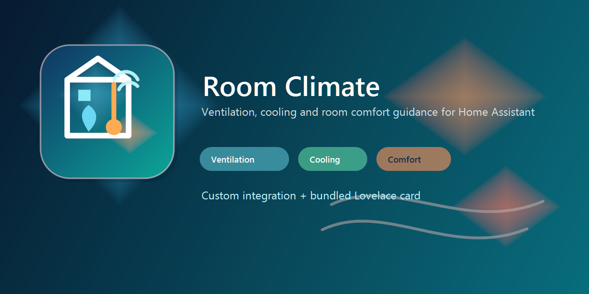

# Room Climate



Custom Home Assistant integration with bundled Lovelace card.

Features:

- room climate scoring per room
- separate advice for dehumidifying and cooling
- hourly ventilation window forecast from `weather.*`
- house-wide cross-ventilation and shock-ventilation recommendations
- immediate updates when a configured window contact changes
- restart-safe ventilation countdown with continued-benefit and close-window guidance
- forecast windows evaluated from temperature and absolute humidity
- absolute humidity calculated from temperature and relative humidity when no dedicated sensor is configured (inside and outside)
- cooling thresholds derived from each room profile (comfort maximum + 2 °C, at least 24 °C); no cooling advice below 12 °C outside (heating season); basements are never ventilated for cooling
- hysteresis while a window is open, so advice does not flip around a threshold
- house-wide daily briefing with weather-based day type and prioritised actions
- optional `sun.sun` and window orientation handling
- mould risk estimate: relative humidity at the coldest exterior wall (DIN 4108-2 temperature factor, configurable wall insulation); reported once it has lasted 60 minutes, so a shower does not raise an alarm
- optional thermostat per room (auto-detected from the room's area): heating-season detection and hints to turn the heating down while a window is open or the room is too warm
- binary sensors for:
  - ventilate now
  - close window
  - close cover / roller shade
  - mould risk
  - reduce heating
- optional push notifications via any `notify.*` service
- bundled `custom:room-climate-card` auto-loaded by the integration

## HACS

Add this repository as a custom integration repository in HACS and install it as an integration.

After restart:

1. Add the integration in Home Assistant.
2. Configure global entities and rooms via the integration options.
3. Use the Lovelace card type:

```yaml
type: custom:room-climate-card
# optional
title: Raumklima
mode: detailed   # detailed | compact | grouped (list)
columns: 2
sort: attention  # attention (rooms that need action first) | name
```

The card lists only actionable advice per room and shows "Kein Handlungsbedarf" otherwise. The old card-only configuration with a `rooms:` list still works but is deprecated and will be removed in a future version.

You do not need to add a separate Lovelace resource manually. The integration registers the card automatically.

After installing or updating the integration, restart Home Assistant and reload the browser once (Ctrl+F5). This lets the active frontend session load the bundled card module. If a reverse proxy or a kiosk browser blocks dynamic resources, add `/room-climate/room-climate-card.js` as a **JavaScript module** under Settings > Dashboards > Resources.

## Created Entities

For the whole installation, the integration creates:

- `sensor.room_climate_tageslage` (actual entity ID depends on your integration name)
- `sensor.room_climate_hausluftung` with the current house-wide recommendation
- `sensor.room_climate_nachstes_luftungsfenster` with the best forecast window

The day briefing classifies the next 24 hours as a cool, mild, summer, or hot day. Its attributes contain the forecast range, average room score, most affected room, and a ready-to-use action summary for dashboards and automations. The bundled card displays this briefing automatically.

The house-wide ventilation sensor is derived from the per-room decisions, so it never recommends ventilation that the rooms would reject. It combines the configured room windows and their orientations. Opposing orientations are used for cross-ventilation guidance. When a window opens, its state updates immediately and a restart-safe countdown begins. Current room values are checked throughout the session, so the recommendation changes to `Lüften beenden` as soon as the outside-air advantage ends. If the advantage still exists after the calculated minimum time, it changes to `Weiterlüften`. A maximum of 10 minutes in cold weather (below 5 °C) and 20 minutes otherwise prevents an open-ended recommendation. When a session ends, the room's `close_window` binary sensor turns on and a push notification is sent. The sensor state only changes with the phase; the remaining minutes are available in the `session_detail` and `session_remaining_minutes` attributes. The forecast sensor calculates expected absolute humidity from hourly temperature and relative humidity and groups suitable hours into one recommended window. Both recommendations are also displayed as separate blocks in the bundled card.

For each configured room, the integration creates:

- `sensor.<room>_score`
- `sensor.<room>_recommendation`
- `binary_sensor.<room>_ventilate_now`
- `binary_sensor.<room>_close_window`
- `binary_sensor.<room>_close_cover`

## Notes

- Push notifications are sent only when the recommendation changes from inactive to active.
- A configurable cooldown prevents repeated notifications. "Close window" pushes wait until the window has been open for 3 minutes.
- The `Score` exposes `inputs_available` and `data_quality`. A score is only calculated when current room temperature and humidity readings are available; readings that have not been reported for more than 3 hours are marked `stale`. Missing or stale readings never trigger ventilation, close-window or cover actions.
- The score uses Thermal Comfort sensors (Scharlau, Humidex, dew point, Simmer) when configured. Without them it is calculated from temperature and humidity against the room profile, so rooms without these sensors can still reach "Ideal".
- Weather values are converted to °C and km/h regardless of the units of the weather entity.
- Requires Home Assistant 2025.2 or newer.
- Regular calculations run every five minutes. Window changes trigger an immediate refresh, and an active ventilation session refreshes once per minute.
- The bundled Lovelace card is still useful for rich per-room display, while the integration handles backend logic and automation-friendly entities.

## Stable states for automations

Since 0.4 these sensors use stable keys as state (shown translated in the UI):

| Sensor | States |
| --- | --- |
| House ventilation | `keep_windows_closed`, `shock_ventilation_recommended`, `cross_ventilation_recommended`, `ventilation_active`, `cross_ventilation_active`, `ventilation_active_limited`, `ventilation_continue`, `close_windows`, `unknown` |
| Day briefing | `hot`, `summer`, `mild`, `cool` |
| Room recommendation | `excellent`, `good`, `medium`, `warning`, `bad`, `critical`, `unknown` |

The German display text is available in the `title` (house ventilation), `day_type` (day briefing) and `level` (recommendation) attributes.

## Development

```bash
pip install -r requirements_test.txt
pytest tests
```

`tests/integration` runs the integration in a real Home Assistant via `pytest-homeassistant-custom-component`.
